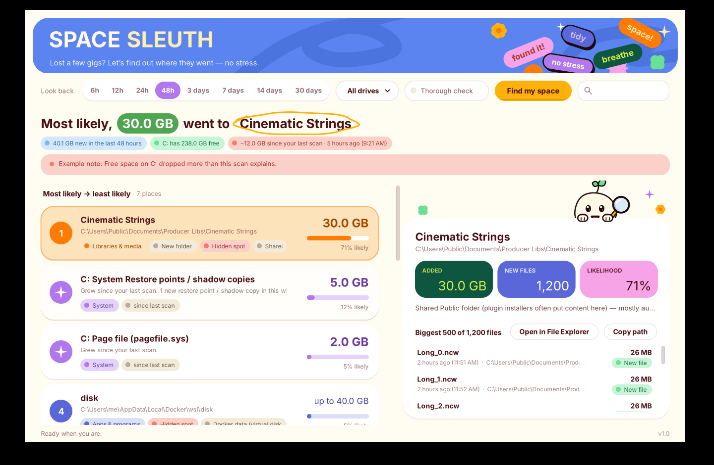

# Space Sleuth

**A tiny Windows 11 app that answers one question: _where did my disk space just go?_**

You had 250 GB free this morning and 238 GB now. Space Sleuth looks at what changed on your drives in the last few hours or days and gives you a ranked list, from the most likely place your space went to the least likely:

| # | Likelihood | Space added | Where | What it probably is |
|---|---|---|---|---|
| 1 | 71% | 30.2 GB | `C:\Users\Public\Documents\Cinematic Strings` | Shared Public folder · Mostly audio samples (.ncw 98%) · **New folder** · *in a folder most people never open* |
| 2 | 19% | 8.0 GB | C: System Restore points / shadow copies | Grew since your last scan |
| 3 | 6% | 2.4 GB | `C:\Users\you\Downloads` | Downloads folder · Mostly installers |
| 4 | <1% | 100 MB | `C:\Program Files\CoolSynth` | Installed program: CoolSynth |
| | 3% | 1.1 GB | Many small changes in different folders | App updates, caches, logs |

Click any card to see the individual files. Double-click to open it in File Explorer.



## Look & feel

Cream paper, oxblood ink and candy-colored stickers. Each kind of place keeps one color everywhere: **orange** = libraries & media (sample packs, video), **sky** = your files, **indigo** = apps & programs, **pink** = games, **mint** = caches & temp, **purple** = system space. A little pebble mascot with a magnifying glass keeps you company while it looks around. If you've turned off animation effects in Windows, nothing bobs or slides.

## Download

Go to **Releases → latest** on this repo and download **`SpaceSleuth-Setup.exe`**. Run it to install Space Sleuth like any other program: it adds a Start menu shortcut (and a desktop icon if you want one), and you can uninstall it any time from **Settings → Apps**.

Prefer no install? `SpaceSleuth.exe` on the same page is the whole app in one file (well under 1 MB). Just run it.

The first time, Windows SmartScreen may say *"Windows protected your PC"* because the app isn't code-signed. Click **More info → Run anyway**. Space Sleuth asks for administrator rights, which it needs to read Windows' change log and restore-point info.

## How it works

1. **Windows' change journal.** NTFS drives keep a log (the USN journal) of every file created, grown, renamed or deleted. Space Sleuth reads it the same way the *Everything* search tool does, so it usually doesn't have to crawl your whole drive.
2. **File dates as a backup.** If the change log doesn't reach back far enough, if the drive isn't NTFS (e.g. an exFAT external sample drive), or if you tick **Thorough**, it also checks the created/modified date of every file.
3. **Finding the culprit folder.** All the new data is added up into a folder tree. A brand-new folder (an install, an unzipped pack, a sample library) is reported as one item. Busy folders like `AppData` or `Downloads` are broken down into the specific things inside them.
4. **Likelihood** = that item's share of all the new data found. Things we're certain about (new files) count fully. Existing files that were merely modified count only a little, because we don't know their size before.
5. **System space.** Restore points/shadow copies, the hibernation file, the page file, the swap file, crash dumps and the Recycle Bin are measured separately and listed in their own section.
6. **Memory between scans.** Each scan saves a small history file (`%LOCALAPPDATA%\SpaceSleuth\history.txt`). Next time, the app can say *"free space dropped 11.7 GB since your last scan"* and measure exactly how much restore points and big existing files (game files, virtual disks) grew.

It also recognises common locations: Steam/Epic/Xbox games, Windows Update caches, browser caches, Docker/WSL disks, and music-production content (Kontakt/Native Instruments, Spitfire, Splice, Ableton, FL Studio, Arturia, Spectrasonics, Toontrack, audio plugin folders, and more). Folders hidden from normal view (AppData, ProgramData, the Public folder) are flagged.

Space Sleuth only reads. It never deletes or changes anything.

## Building

GitHub Actions builds `SpaceSleuth.exe` and the installer `SpaceSleuth-Setup.exe` (made with [Inno Setup](https://jrsoftware.org/isinfo.php) from `installer/SpaceSleuth.iss`) on every push to `main`, and publishes both as the `latest` release. To build locally on Windows with the .NET SDK installed:

```
dotnet build src/SpaceSleuth/SpaceSleuth.csproj -c Release -o out
```

The app targets .NET Framework 4.8, which is built into Windows 11, so the .exe has no dependencies.

## Credits

The wordmark uses [Unbounded](https://github.com/googlefonts/unbounded) (SIL Open Font License, see `licenses/Unbounded-OFL.txt`), embedded in the app. Everything else uses Windows' own Segoe UI.
